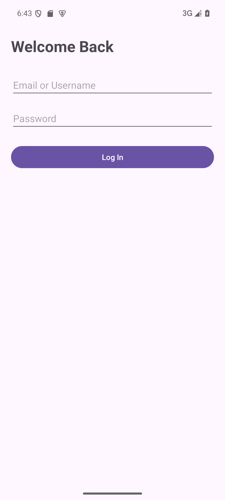
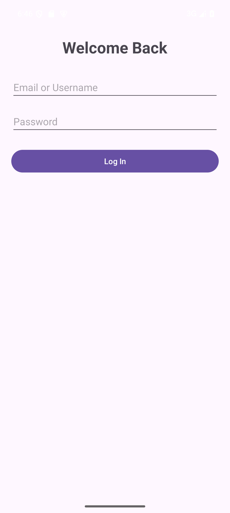
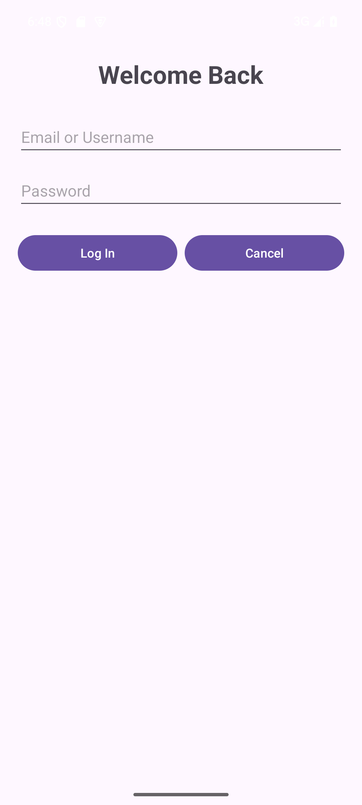
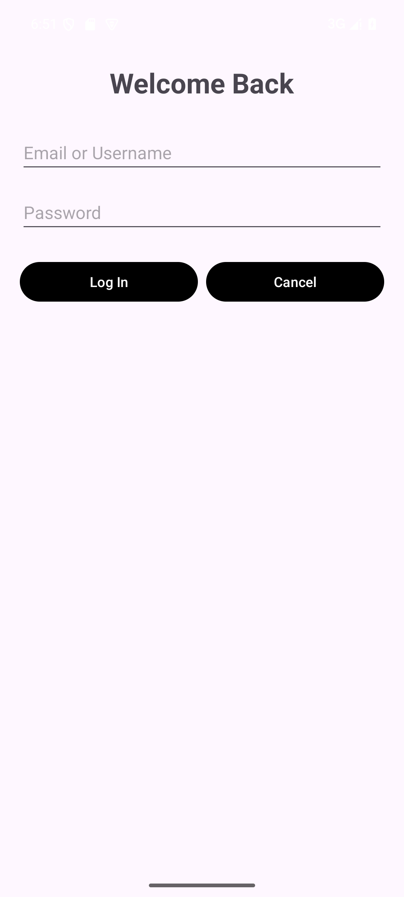

# Practical 3 - Version Control System

Student ID: **20243007024**

This is the provided Android login project, cloned using HTTPS from
https://github.com/jibrilmuhammadadam/Practical3_GitHub.git.
The original commit and its history have been preserved.

## Development history

| Stage | Commit | Change |
| --- | --- | --- |
| Commit 001 | `85bd8ad` | Instructor's original login UI |
| Commit 002 | `15420d9` | Centered Welcome Back horizontally |
| Commit 003 | `b59d9ca` | Added Cancel beside Log In using equal layout weights |
| Commit 004 | `d18e7a9` | Changed both button backgrounds to black on `feature-button-background-color` |
| Merge | `b5fe4ec` | Merged the feature branch into `master`, retaining a merge commit |

The feature branch remains available. The merge commit has two parents, so the
branch and merge can be inspected with:

```sh
git log --graph --oneline --decorate --all
git show --summary b5fe4ec
git branch --contains d18e7a9
git status
git remote -v
```

## Run in Android Studio

Open this folder (the one containing `settings.gradle.kts`), wait for Gradle Sync,
select the `app` run configuration and a device, then click Run.
The project uses the supplied Gradle 9.6.0 / AGP 9.4.1 configuration and JDK 25.
`local.properties` is machine-specific and excluded from Git.

The Log In demonstration from the instructor is unchanged. It uses classroom-only
sample credentials in `MainActivity.java`, not a real authentication service.
Cancel is a UI control as requested by the practical; no extra click behavior
was required by the brief.

## Verification

- Original app and every required UI modification: built, installed and launched
  on a Pixel 6 Android API 35 emulator.
- Each stage was visually checked before its corresponding change was committed.
- Final feature: `assembleDebug` and `lintDebug` succeeded; Lint reported 0 errors
  and 12 warnings (including inherited template/style recommendations).
- Both buttons are black with white labels; Welcome Back remains centered.
- `master` contains Commit 004, and the feature branch is retained.

| Original | Centered title |
| --- | --- |
|  |  |

| Cancel added | Final black buttons |
| --- | --- |
|  |  |

## Remote submission still required

At the time of local verification, a student-owned remote URL had not yet been
provided. Local development and the merge were completed; remote creation,
changing origin, pushes, remote verification and Canvas submission remain pending.
No pushes have been made to the instructor's repository.

Create a **Public**, initially empty GitHub repository named
`20243007024-VersionControlSystem` (do not initialize it with a README, license
or .gitignore). Connect this local repository to its HTTPS URL, push `master` and
`feature-button-background-color`, and push any tags. Verify both branches and the
original commit online. Submit the public repository homepage URL on Canvas.
The local README is meant to be pushed with the existing history, not generated
by GitHub during empty-repository creation.

## Reflection

Git lets a large team trace changes to individual commits, review focused diffs,
and recover a known working version. Feature branches isolate unfinished work;
merging integrates reviewed changes. Remote repositories share that history and
allow developers to fetch and reconcile each other's work. Testing before merging
reduces regressions, while meaningful messages explain why the system evolved.
